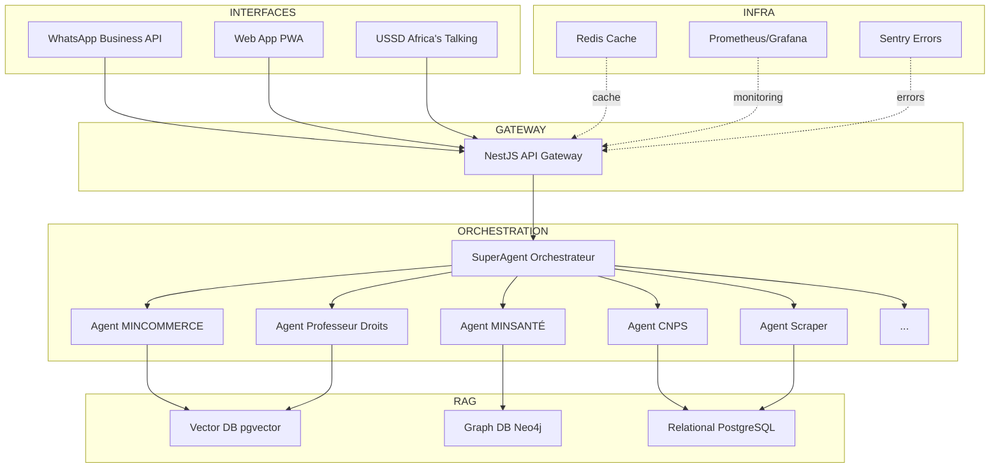

# SONAH - Guide de Génération des Maquettes Visuelles

Ce document décrit précisément comment générer les maquettes visuelles pour SONAH.
Utilisez un outil de design (Figma, Canva, Photoshop) ou un générateur d'images IA (DALL-E, Midjourney).

---

## 1. Maquettes WhatsApp (4 conversations)

### Spécifications Techniques
- **Format :** Mobile vertical (375 × 812 px - iPhone X)
- **Police :** System font (SF Pro / Roboto)
- **Couleurs :**
  - Fond conversation : #E5DDD5 (beige WhatsApp)
  - Bulles SONAH (bot) : #FFFFFF (blanc)
  - Bulles utilisateur : #DCF8C6 (vert clair WhatsApp)
  - Texte : #000000
  - Heure : #999999

### Maquette 1 : Menu Principal + Création Restaurant

```
┌─────────────────────────────────────┐
│  < SONAH                       [⋮]  │
├─────────────────────────────────────┤
│                                     │
│  ┌─────────────────────────────┐   │
│  │ Bonjour ! Je t'aide dans    │   │
│  │ tes démarches               │   │
│  │ administratives 🇨🇲          │   │
│  │                             │   │
│  │ 1️⃣ Créer entreprise          │   │
│  │ 2️⃣ Documents identité        │   │
│  │ 3️⃣ Droits & violations       │   │
│  │ 4️⃣ Santé/CNPS                │   │
│  │ 5️⃣ État civil                │   │
│  │ 6️⃣ Impôts                    │   │
│  │                        10:24 │   │
│  └─────────────────────────────┘   │
│                                     │
│          ┌──────────────────┐      │
│          │ Je veux ouvrir   │      │
│          │ un restaurant à  │      │
│          │ Yaoundé      10:25│      │
│          └──────────────────┘      │
│                                     │
│  ┌─────────────────────────────┐   │
│  │ Super projet ! 🍽️            │   │
│  │                             │   │
│  │ Tu dois obtenir 3           │   │
│  │ autorisations :             │   │
│  │                             │   │
│  │ ✅ MINCOMMERCE              │   │
│  │    Durée : 3 jours          │   │
│  │    Coût : 25 000 FCFA       │   │
│  │                             │   │
│  │ ✅ MINSANTÉ                 │   │
│  │    Durée : 7 jours          │   │
│  │    Coût : 15 000 FCFA       │   │
│  │                             │   │
│  │ ✅ Mairie de Yaoundé        │   │
│  │    Durée : 11 jours         │   │
│  │    Coût : 38 500 FCFA       │   │
│  │                        10:25 │   │
│  └─────────────────────────────┘   │
│                                     │
│  ┌─────────────────────────────┐   │
│  │ 📊 TOTAL                    │   │
│  │ ⏱️ ~21 jours                 │   │
│  │ 💰 78 500 FCFA              │   │
│  │                             │   │
│  │ Je coordonne tout pour      │   │
│  │ toi ! 🚀                     │   │
│  │                             │   │
│  │ Commencer maintenant ?      │   │
│  │ ┌─────┐  ┌──────────────┐  │   │
│  │ │ Oui │  │ Plus d'infos │  │   │
│  │ └─────┘  └──────────────┘  │   │
│  │                        10:26 │   │
│  └─────────────────────────────┘   │
│                                     │
└─────────────────────────────────────┘
```

**Instructions de design :**
- Header WhatsApp : fond #075E54 (vert WhatsApp), texte blanc
- Icône SONAH : logo Cameroun stylisé ou robot bleu
- Boutons : fond blanc, bordure #128C7E, texte #128C7E
- Espacement : 8px entre bulles, 16px padding intérieur

---

### Maquette 2 : Violation Salaire Impayé

```
┌─────────────────────────────────────┐
│  < SONAH                       [⋮]  │
├─────────────────────────────────────┤
│                                     │
│          ┌──────────────────┐      │
│          │ Mon patron ne    │      │
│          │ m'a pas payé     │      │
│          │ depuis 3 mois    │      │
│          │              14:35│      │
│          └──────────────────┘      │
│                                     │
│  ┌─────────────────────────────┐   │
│  │ ⚠️ VIOLATION GRAVE          │   │
│  │    DÉTECTÉE                 │   │
│  │                             │   │
│  │ Articles violés :           │   │
│  │                             │   │
│  │ 📜 Constitution Art. 27     │   │
│  │ "Le salaire dû au travail   │   │
│  │ est inviolable"             │   │
│  │                             │   │
│  │ 📜 Code du Travail Art. 62  │   │
│  │ "Le salaire doit être payé  │   │
│  │ au moins 1x/mois"           │   │
│  │                        14:35 │   │
│  └─────────────────────────────┘   │
│                                     │
│  ┌─────────────────────────────┐   │
│  │ 🎯 RECOURS DISPONIBLES      │   │
│  │                             │   │
│  │ 1️⃣ Inspection du Travail    │   │
│  │    ✓ GRATUIT                │   │
│  │    ✓ 15 jours en moyenne    │   │
│  │    ✓ Taux de succès : 87%   │   │
│  │                             │   │
│  │ 2️⃣ Tribunal du Travail      │   │
│  │    • Coût : variable        │   │
│  │    • 3-6 mois               │   │
│  │                             │   │
│  │ Je génère ta plainte pour   │   │
│  │ l'Inspection ?              │   │
│  │ ┌──────────┐  ┌──────────┐ │   │
│  │ │Oui,      │  │En savoir │ │   │
│  │ │générer   │  │plus      │ │   │
│  │ └──────────┘  └──────────┘ │   │
│  │                        14:36 │   │
│  └─────────────────────────────┘   │
│                                     │
└─────────────────────────────────────┘
```

**Instructions de design :**
- Icône ⚠️ : rouge #D32F2F
- Citations juridiques : italique, fond #F5F5F5, bordure gauche bleue 4px
- Checkmarks ✓ : vert #4CAF50
- Boutons : même style que Maquette 1

---

### Maquette 3 : Alerte Nouvelle Loi

```
┌─────────────────────────────────────┐
│  < SONAH                       [⋮]  │
├─────────────────────────────────────┤
│                                     │
│  ┌─────────────────────────────┐   │
│  │ 🔔 ALERTE PERSONNALISÉE     │   │
│  │                             │   │
│  │ 📜 Nouvelle loi te          │   │
│  │    concernant !             │   │
│  │                             │   │
│  │ Décret n°2026/456/PM        │   │
│  │ du 10 Oct 2026              │   │
│  │ "Exonération fiscale        │   │
│  │ startups tech - 3 ans"      │   │
│  │                             │   │
│  │ 🎯 Impact pour toi :        │   │
│  │ • Économie : 850k FCFA/an   │   │
│  │ • Total : 2,55M FCFA        │   │
│  │   économisés !              │   │
│  │                             │   │
│  │ ⏰ Deadline : 30 Oct 2026   │   │
│  │    (dans 20 jours)          │   │
│  │                        09:15 │   │
│  └─────────────────────────────┘   │
│                                     │
│  ┌─────────────────────────────┐   │
│  │ 📋 Documents requis :       │   │
│  │                             │   │
│  │ 1. Registre commerce        │   │
│  │    (tu l'as ✅)             │   │
│  │ 2. Déclaration activité     │   │
│  │    tech                     │   │
│  │ 3. Bilan financier N-1      │   │
│  │ 4. Statuts entreprise       │   │
│  │ 5. CNI dirigeants           │   │
│  │ 6. Justificatif             │   │
│  │    domiciliation            │   │
│  │ 7. Formulaire MINFI         │   │
│  │    EXO-TECH-2026            │   │
│  │                             │   │
│  │ Je te guide pour            │   │
│  │ candidater ?                │   │
│  │ ┌────┐ ┌────────┐ ┌──────┐ │   │
│  │ │Oui,│ │Détails │ │Me    │ │   │
│  │ │go! │ │complets│ │rappel│ │   │
│  │ └────┘ └────────┘ │ds 5j │ │   │
│  │                   └──────┘ │   │
│  │                        09:15 │   │
│  └─────────────────────────────┘   │
│                                     │
└─────────────────────────────────────┘
```

**Instructions de design :**
- Icône 🔔 : animation pulsante (optionnel)
- Highlight deadline : fond jaune #FFF9C4
- Liste numérotée : police monospace pour les numéros
- 3 boutons : alignés horizontalement, taille adaptative

---

### Maquette 4 : Génération Document PDF

```
┌─────────────────────────────────────┐
│  < SONAH                       [⋮]  │
├─────────────────────────────────────┤
│                                     │
│          ┌──────────────────┐      │
│          │ Oui, générer     │      │
│          │ maintenant   16:42│      │
│          └──────────────────┘      │
│                                     │
│  ┌─────────────────────────────┐   │
│  │ Parfait ! J'ai besoin de    │   │
│  │ quelques infos :            │   │
│  │                             │   │
│  │ 1️⃣ Ton nom complet ?        │   │
│  │                        16:42 │   │
│  └─────────────────────────────┘   │
│                                     │
│          ┌──────────────────┐      │
│          │ Jean TAMBA   16:43│      │
│          └──────────────────┘      │
│                                     │
│  ┌─────────────────────────────┐   │
│  │ 2️⃣ Nom de ton employeur ?   │   │
│  │                        16:43 │   │
│  └─────────────────────────────┘   │
│                                     │
│          ┌──────────────────┐      │
│          │ SARL CAMTECH 16:43│      │
│          └──────────────────┘      │
│                                     │
│  ┌─────────────────────────────┐   │
│  │ 3️⃣ Montant total impayé ?   │   │
│  │                        16:43 │   │
│  └─────────────────────────────┘   │
│                                     │
│          ┌──────────────────┐      │
│          │ 900 000 FCFA 16:44│      │
│          └──────────────────┘      │
│                                     │
│  ┌─────────────────────────────┐   │
│  │ ✅ Plainte générée !        │   │
│  │                             │   │
│  │ ┌─────────────────────────┐ │   │
│  │ │  📄                      │ │   │
│  │ │  Plainte_Inspection_    │ │   │
│  │ │  Travail_Jean_TAMBA.pdf │ │   │
│  │ │  2 pages • 245 KB       │ │   │
│  │ │                         │ │   │
│  │ │  [Télécharger PDF]      │ │   │
│  │ └─────────────────────────┘ │   │
│  │                        16:44 │   │
│  └─────────────────────────────┘   │
│                                     │
│  ┌─────────────────────────────┐   │
│  │ 📍 Inspection du Travail    │   │
│  │    - Yaoundé                │   │
│  │                             │   │
│  │ Adresse : Avenue Kennedy,   │   │
│  │ Immeuble MINEMPLOI          │   │
│  │                             │   │
│  │ Horaires : Lu-Ve, 8h-15h    │   │
│  │ Tél : +237 222 23 45 67     │   │
│  │                             │   │
│  │ 📋 Documents à apporter :   │   │
│  │ ✓ Ta plainte (imprimée)     │   │
│  │ ✓ Ta CNI                    │   │
│  │ ✓ Bulletins de paie (si tu  │   │
│  │   en as)                    │   │
│  │                             │   │
│  │ Je te rappelle la veille du │   │
│  │ rendez-vous ?               │   │
│  │ ┌─────┐  ┌──────────────┐  │   │
│  │ │ Oui │  │ Non merci    │  │   │
│  │ └─────┘  └──────────────┘  │   │
│  │                        16:45 │   │
│  └─────────────────────────────┘   │
│                                     │
└─────────────────────────────────────┘
```

**Instructions de design :**
- Bloc PDF : fond #F5F5F5, icône 📄 grande taille
- Bouton "Télécharger PDF" : bleu #1976D2, texte blanc
- Section contact : fond très léger #FAFAFA
- Icônes checkmark : vert #4CAF50

---

## 2. Maquettes Web App (3 pages)

### Spécifications Techniques
- **Format :** Desktop (1920 × 1080 px)
- **Framework visuel :** Style moderne type Tailwind/shadcn
- **Couleurs principales :**
  - Bleu primaire : #1E40AF
  - Vert secondaire : #059669
  - Orange accents : #F59E0B
  - Gris backgrounds : #F9FAFB, #E5E7EB
  - Texte : #111827

### Maquette Web 1 : Dashboard Principal

```
┌────────────────────────────────────────────────────────────────────┐
│ SONAH    [🏠 Accueil] [📊 Démarches] [⚖️ Droits] [👤 Marie K.] [🔔3]│
├────────────────────────────────────────────────────────────────────┤
│                                                                    │
│  Bienvenue, Marie Kouam                                           │
│                                                                    │
│  ┌──────────────────┐ ┌──────────────────┐ ┌──────────────────┐  │
│  │ 2 Démarches      │ │ 21 jours         │ │ 78 500 FCFA      │  │
│  │ en cours         │ │ économisés       │ │ économisés       │  │
│  │ ━━━━━━━━━━━━━━━━ │ │ ━━━━━━━━━━━━━━━━ │ │ ━━━━━━━━━━━━━━━━ │  │
│  │      📋          │ │      ⏱️           │ │      💰          │  │
│  └──────────────────┘ └──────────────────┘ └──────────────────┘  │
│                                                                    │
│  ┏━━━━━━━━━━━━━━━━━━━━━━━━━━━━━━━━━━━━━━━━━━━━━━━━━━━━━━━━━━━━┓  │
│  ┃ 📋 Démarches en Cours                                        ┃  │
│  ┣━━━━━━━━━━━━━━━━━━━━━━━━━━━━━━━━━━━━━━━━━━━━━━━━━━━━━━━━━━━━┫  │
│  ┃                                                              ┃  │
│  ┃ Restaurant "Chez Marie"                            [67%]    ┃  │
│  ┃ ━━━━━━━━━━━━━━━━━━━━━━━━━━━━━━━━━━━━━━━━━━━━━━━━━━━━━━━━━  ┃  │
│  ┃                                                              ┃  │
│  ┃ ✅ MINCOMMERCE (Terminé - 3j)                               ┃  │
│  ┃    Registre de commerce obtenu le 05 Oct 2026               ┃  │
│  ┃                                                              ┃  │
│  ┃ ⏳ MINSANTÉ (En cours - 4/7j restants)                      ┃  │
│  ┃    Certificat sanitaire en traitement                       ┃  │
│  ┃    Inspection prévue : 16 Oct 2026                          ┃  │
│  ┃                                                              ┃  │
│  ┃ ⏸️ Mairie (En attente des certificats)                      ┃  │
│  ┃    Démarrage prévu : 18 Oct 2026                            ┃  │
│  ┃                                                              ┃  │
│  ┃ Prochaine action : Récupérer certificat MINSANTÉ            ┃  │
│  ┃ Deadline : 15 Oct 2026                                       ┃  │
│  ┃                                                              ┃  │
│  ┃                        [Voir détails] [Contacter support]   ┃  │
│  ┗━━━━━━━━━━━━━━━━━━━━━━━━━━━━━━━━━━━━━━━━━━━━━━━━━━━━━━━━━━━━┛  │
│                                                                    │
│  ┏━━━━━━━━━━━━━━━━━━━━━━━━━━━━━━━━━━━━━━━━━━━━━━━━━━━━━━━━━━━━┓  │
│  ┃ 🔔 Alertes Personnalisées                                   ┃  │
│  ┣━━━━━━━━━━━━━━━━━━━━━━━━━━━━━━━━━━━━━━━━━━━━━━━━━━━━━━━━━━━━┫  │
│  ┃                                                              ┃  │
│  ┃ ⚡ NOUVEAU ! Exonération fiscale startups tech              ┃  │
│  ┃    Deadline : 30 Oct 2026 (dans 18 jours)                   ┃  │
│  ┃    Économie estimée : 850 000 FCFA/an                       ┃  │
│  ┃                                                              ┃  │
│  ┃                                          [En savoir plus]   ┃  │
│  ┗━━━━━━━━━━━━━━━━━━━━━━━━━━━━━━━━━━━━━━━━━━━━━━━━━━━━━━━━━━━━┛  │
│                                                                    │
└────────────────────────────────────────────────────────────────────┘
```

**Instructions de design :**
- Header : sticky, fond blanc, ombre subtile
- Cartes métriques : shadow-md, coins arrondis 12px
- Barre de progression : gradient bleu (#1E40AF → #3B82F6)
- Icônes status : ✅ vert, ⏳ orange, ⏸️ gris
- Section alertes : fond orange très léger (#FFF7ED), bordure orange

---

### Maquette Web 2 : Orchestration Multi-Agents

```
┌────────────────────────────────────────────────────────────────────┐
│ SONAH > Orchestration > Restaurant "Chez Marie"                    │
├────────────────────────────────────────────────────────────────────┤
│                                                                    │
│  🤖 Agents impliqués : 3/15                                        │
│                                                                    │
│                    [Demande Citoyenne]                             │
│                    "Ouvrir Restaurant"                             │
│                           │                                        │
│                           ▼                                        │
│                  [SuperAgent Orchestrateur]                        │
│                     /      |      \                                │
│                    /       |       \                               │
│                   /        |        \                              │
│                  ▼         ▼         ▼                             │
│           [Agent        [Agent      [Agent                         │
│          MINCOMMERCE]  MINSANTÉ]   Mairie]                        │
│                                                                    │
│  ┏━━━━━━━━━━━━━━━━━━━━━━━━━━━━━━━━━━━━━━━━━━━━━━━━━━━━━━━━━━━━┓  │
│  ┃ Timeline Optimisée                                           ┃  │
│  ┣━━━━━━━━━━━━━━━━━━━━━━━━━━━━━━━━━━━━━━━━━━━━━━━━━━━━━━━━━━━━┫  │
│  ┃                                                              ┃  │
│  ┃ Jour 0 ━━━━━━━━━━━━━━━━━━━━━━━━━━━━━━━━━━━━━━━━━━━ Jour 21 ┃  │
│  ┃                                                              ┃  │
│  ┃ MINCOMMERCE ███████ (3j)                                    ┃  │
│  ┃ MINSANTÉ    ████████████████ (7j)                           ┃  │
│  ┃ Mairie                         ██████████████████████ (11j) ┃  │
│  ┃                                                              ┃  │
│  ┃ ✅ Exécution en PARALLÈLE détectée automatiquement          ┃  │
│  ┃    Gain de temps : 69 jours (-77%)                          ┃  │
│  ┗━━━━━━━━━━━━━━━━━━━━━━━━━━━━━━━━━━━━━━━━━━━━━━━━━━━━━━━━━━━━┛  │
│                                                                    │
│  ┏━━━━━━━━━━━━━━━━━━━━━━━━━━━━━━━━━━━━━━━━━━━━━━━━━━━━━━━━━━━━┓  │
│  ┃ 📊 Comparaison                                               ┃  │
│  ┣━━━━━━━━━━━━━━━━━━━━━━━━━━━━━━━━━━━━━━━━━━━━━━━━━━━━━━━━━━━━┫  │
│  ┃                                                              ┃  │
│  ┃ Sans SONAH :  90 jours, 127k FCFA, 15 déplacements, 40% ✓  ┃  │
│  ┃ Avec SONAH :  21 jours,  78k FCFA,  3 déplacements, 82% ✓  ┃  │
│  ┃                                                              ┃  │
│  ┃ ━━━━━━━━━━━━━━━━━━━━━━━━━━━━━━━━━━━━━━━━━━━━━━━━━━━━━━━━  ┃  │
│  ┃                                                              ┃  │
│  ┃ Gains totaux :                                               ┃  │
│  ┃ • Temps : -69 jours (-77%)                                   ┃  │
│  ┃ • Coût : -49k FCFA (-38%)                                    ┃  │
│  ┃ • Déplacements : -12 (-80%)                                  ┃  │
│  ┃ • Taux de succès : +42% (+105%)                              ┃  │
│  ┗━━━━━━━━━━━━━━━━━━━━━━━━━━━━━━━━━━━━━━━━━━━━━━━━━━━━━━━━━━━━┛  │
│                                                                    │
└────────────────────────────────────────────────────────────────────┘
```

**Instructions de design :**
- Graphe agents : utiliser bibliothèque D3.js ou schéma SVG
- Noeuds : rectangles arrondis, ombre, icônes ministères
- Connexions : flèches SVG, animation pulse (optionnel)
- Timeline : barres horizontales, couleurs distinctes par agent
- Tableau comparatif : rouge pour "Sans SONAH", vert pour "Avec SONAH"

---

### Maquette Web 3 : Professeur de Droits

```
┌────────────────────────────────────────────────────────────────────┐
│ SONAH > Professeur de Droits                                       │
├────────────────────────────────────────────────────────────────────┤
│                                                                    │
│  🔍 Recherche dans la Constitution et les Lois                     │
│  ┏━━━━━━━━━━━━━━━━━━━━━━━━━━━━━━━━━━━━━━━━━━━━━━━━━━━━━━━━━━━━┓  │
│  ┃ [salaire impayé]                              [🔍 Rechercher]┃  │
│  ┗━━━━━━━━━━━━━━━━━━━━━━━━━━━━━━━━━━━━━━━━━━━━━━━━━━━━━━━━━━━━┛  │
│                                                                    │
│  📜 Résultats (3 articles trouvés)                                 │
│                                                                    │
│  ┏━━━━━━━━━━━━━━━━━━━━━━━━━━━━━━━━━━━━━━━━━━━━━━━━━━━━━━━━━━━━┓  │
│  ┃ 1. Constitution du Cameroun                                  ┃  │
│  ┃    Article 27                                                 ┃  │
│  ┣━━━━━━━━━━━━━━━━━━━━━━━━━━━━━━━━━━━━━━━━━━━━━━━━━━━━━━━━━━━━┫  │
│  ┃                                                              ┃  │
│  ┃ "Le droit au travail est reconnu et garanti à tous.         ┃  │
│  ┃ Le salaire dû au travail est inviolable."                   ┃  │
│  ┃                                                              ┃  │
│  ┃ Pertinence : ⭐⭐⭐⭐⭐ 94%                                    ┃  │
│  ┃                                                              ┃  │
│  ┃            [Voir détails] [Générer plainte] [Partager]      ┃  │
│  ┗━━━━━━━━━━━━━━━━━━━━━━━━━━━━━━━━━━━━━━━━━━━━━━━━━━━━━━━━━━━━┛  │
│                                                                    │
│  ┏━━━━━━━━━━━━━━━━━━━━━━━━━━━━━━━━━━━━━━━━━━━━━━━━━━━━━━━━━━━━┓  │
│  ┃ 2. Code du Travail                                           ┃  │
│  ┃    Article 62                                                 ┃  │
│  ┣━━━━━━━━━━━━━━━━━━━━━━━━━━━━━━━━━━━━━━━━━━━━━━━━━━━━━━━━━━━━┫  │
│  ┃                                                              ┃  │
│  ┃ "Le salaire doit être payé au moins une fois par mois.      ┃  │
│  ┃ Tout retard de paiement au-delà de 15 jours constitue       ┃  │
│  ┃ une faute grave de l'employeur."                            ┃  │
│  ┃                                                              ┃  │
│  ┃ Pertinence : ⭐⭐⭐⭐⭐ 91%                                    ┃  │
│  ┃                                                              ┃  │
│  ┃            [Voir détails] [Générer plainte] [Partager]      ┃  │
│  ┗━━━━━━━━━━━━━━━━━━━━━━━━━━━━━━━━━━━━━━━━━━━━━━━━━━━━━━━━━━━━┛  │
│                                                                    │
│  ┏━━━━━━━━━━━━━━━━━━━━━━━━━━━━━━━━━━━━━━━━━━━━━━━━━━━━━━━━━━━━┓  │
│  ┃ 3. Code du Travail                                           ┃  │
│  ┃    Article 78 - Saisie sur salaire                           ┃  │
│  ┣━━━━━━━━━━━━━━━━━━━━━━━━━━━━━━━━━━━━━━━━━━━━━━━━━━━━━━━━━━━━┫  │
│  ┃                                                              ┃  │
│  ┃ "Les salaires ne peuvent être saisis que dans les           ┃  │
│  ┃ limites et conditions fixées par la loi..."                 ┃  │
│  ┃                                                              ┃  │
│  ┃ Pertinence : ⭐⭐⭐⭐ 87%                                      ┃  │
│  ┃                                                              ┃  │
│  ┃            [Voir détails] [Générer plainte] [Partager]      ┃  │
│  ┗━━━━━━━━━━━━━━━━━━━━━━━━━━━━━━━━━━━━━━━━━━━━━━━━━━━━━━━━━━━━┛  │
│                                                                    │
│  ┏━━━━━━━━━━━━━━━━━━━━━━━━━━━━━━━━━━━━━━━━━━━━━━━━━━━━━━━━━━━━┓  │
│  ┃ 💡 Recours suggérés                                          ┃  │
│  ┣━━━━━━━━━━━━━━━━━━━━━━━━━━━━━━━━━━━━━━━━━━━━━━━━━━━━━━━━━━━━┫  │
│  ┃                                                              ┃  │
│  ┃ • Inspection du Travail (gratuit, 15 jours, 87% succès)     ┃  │
│  ┃ • Tribunal du Travail (3-6 mois, avocat recommandé, 92%)    ┃  │
│  ┃                                                              ┃  │
│  ┗━━━━━━━━━━━━━━━━━━━━━━━━━━━━━━━━━━━━━━━━━━━━━━━━━━━━━━━━━━━━┛  │
│                                                                    │
└────────────────────────────────────────────────────────────────────┘
```

**Instructions de design :**
- Barre de recherche : grande (60px hauteur), icône loupe, autocomplétion
- Résultats : cartes séparées, ombre légère
- Citations juridiques : police serif (Georgia), italique, couleur #374151
- Bordure gauche bleue (4px) pour chaque citation
- Boutons : outline style, hover avec background
- Étoiles pertinence : gradient jaune/orange

---

## 3. Schémas d'Architecture

### Schéma 1 : Architecture Globale

**Format :** Diagramme vertical 1200 × 1600 px

**Éléments visuels :**
- 5 couches empilées (INTERFACES → API GATEWAY → ORCHESTRATION → RAG → INFRASTRUCTURE)
- Connexions avec flèches
- Icônes pour chaque composant
- Code couleur :
  - Bleu : Interfaces (#1E40AF)
  - Vert : Backend (#059669)
  - Orange : IA/ML (#F59E0B)
  - Gris : Infrastructure (#6B7280)

**Outils recommandés :**
- Draw.io / Diagrams.net
- Lucidchart
- Mermaid.js (code to diagram)
- Figma

**Code Mermaid (pour génération automatique) :**



---

### Schéma 2 : Flux de Traitement Requête

**Format :** Diagramme séquentiel horizontal 1600 × 800 px

**Étapes :**
1. Utilisateur WhatsApp
2. Webhook
3. API Gateway (Auth + Rate Limit)
4. SuperAgent (Analyse intention)
5. Agents spécialisés (parallèle)
6. Triple RAG (queries)
7. Génération réponse (GPT-4o)
8. Retour WhatsApp

**Annotations :**
- Temps par étape (ms)
- Type de données échangées
- Points de cache

---

## 4. Guide de Génération avec IA

Si vous utilisez **DALL-E 3, Midjourney, ou Stable Diffusion** :

### Prompt pour Maquette WhatsApp

```
Generate a professional WhatsApp mobile chat mockup showing a conversation between a user and a bot named SONAH. The interface should have:

- iPhone X screen resolution (375x812px)
- WhatsApp standard UI: green header (#075E54) with "SONAH" title, beige background (#E5DDD5)
- Bot messages in white bubbles on the left
- User messages in light green bubbles (#DCF8C6) on the right
- First bot message shows a menu with emojis: 1️⃣ Créer entreprise, 2️⃣ Documents identité, etc.
- User asks: "Je veux ouvrir un restaurant à Yaoundé"
- Bot responds with detailed breakdown of 3 steps (MINCOMMERCE, MINSANTÉ, Mairie) with durations and costs
- Professional, clean design, realistic WhatsApp styling
- French language
- Modern, accessible UI
```

### Prompt pour Dashboard Web

```
Generate a professional web dashboard interface for SONAH administrative services platform:

- Desktop resolution (1920x1080px)
- Modern design inspired by Tailwind CSS / shadcn/ui
- Header with logo "SONAH", navigation tabs (Accueil, Démarches, Droits), user profile
- 3 metric cards showing: "2 Démarches en cours", "21 jours économisés", "78,500 FCFA économisés"
- Main section showing a progress card for "Restaurant Chez Marie" with progress bar at 67%
- Timeline showing 3 steps: MINCOMMERCE (completed ✅), MINSANTÉ (in progress ⏳), Mairie (pending ⏸️)
- Alert section with orange notification about new tax exemption law
- Color scheme: Blue primary (#1E40AF), green secondary (#059669), orange accents (#F59E0B)
- Clean, professional, government-tech aesthetic
- French language
```

---

## 5. Checklist de Livraison

### Maquettes WhatsApp
- [ ] Maquette 1 : Menu + Création Restaurant (PNG 375×812)
- [ ] Maquette 2 : Violation Salaire (PNG 375×812)
- [ ] Maquette 3 : Alerte Nouvelle Loi (PNG 375×812)
- [ ] Maquette 4 : Génération PDF (PNG 375×812)

### Maquettes Web
- [ ] Dashboard Principal (PNG 1920×1080)
- [ ] Orchestration Multi-Agents (PNG 1920×1080)
- [ ] Professeur de Droits (PNG 1920×1080)

### Schémas
- [ ] Architecture Globale (PNG/SVG 1200×1600)
- [ ] Flux de Traitement (PNG/SVG 1600×800)

### Format Final
- [ ] Toutes les maquettes en haute résolution (300 DPI minimum)
- [ ] Versions PNG + sources modifiables (Figma, Sketch, PSD)
- [ ] Palette de couleurs exportée (JSON ou CSS)
- [ ] Guide de style (polices, espacements, composants réutilisables)

---

## Notes Importantes

1. **Qualité professionnelle** : Les maquettes doivent avoir le même niveau de qualité que les guides TravelLab (pas de mockups "brouillon")

2. **Cohérence visuelle** : Utilisez la même charte graphique sur toutes les maquettes (couleurs, polices, espacements)

3. **Accessibilité** : Contraste WCAG AA minimum (4.5:1 pour texte normal, 3:1 pour texte large)

4. **Responsive** : Les maquettes web devraient avoir des variantes mobile (optionnel mais recommandé)

5. **Réalisme** : Les données affichées doivent être cohérentes avec le document de présentation (mêmes chiffres, mêmes exemples)

6. **Export** : Privilégiez PNG avec transparence pour intégration facile dans le document final

---

**FIN DU GUIDE DE MAQUETTES**
