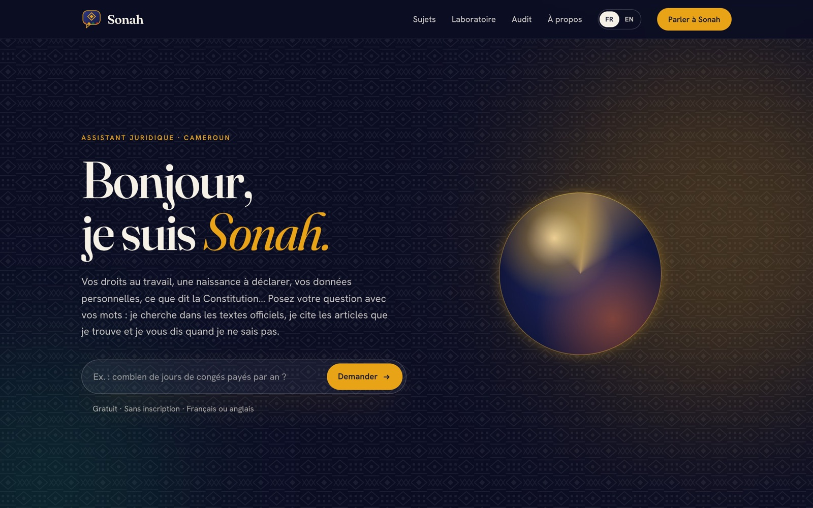
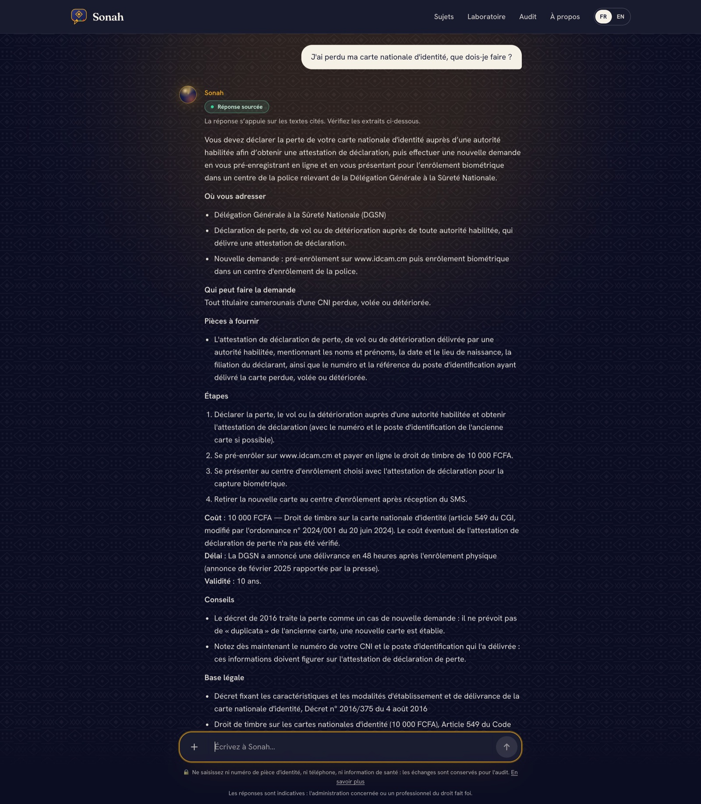
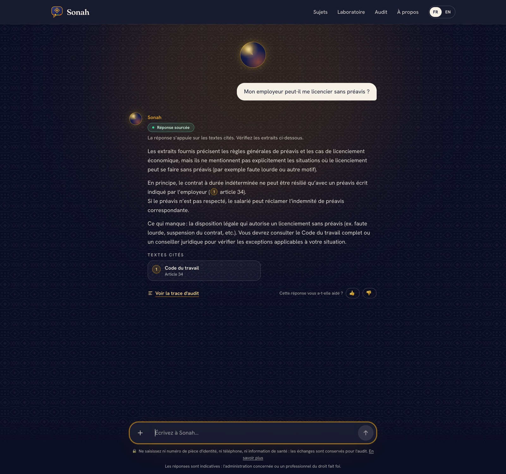
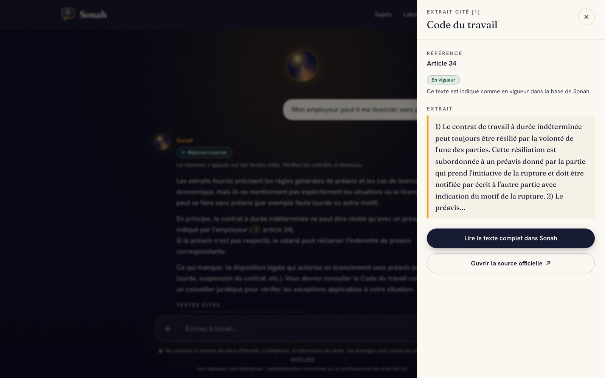
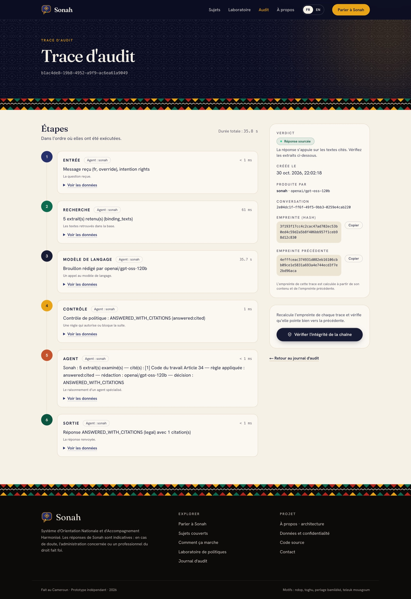
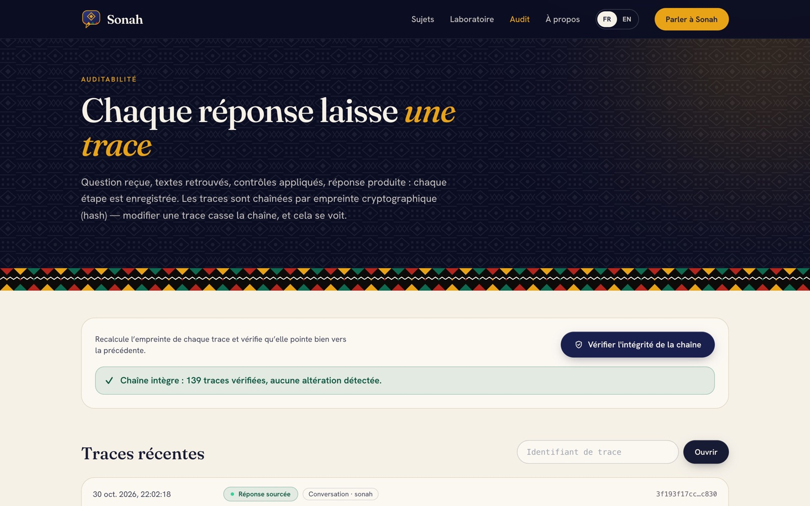
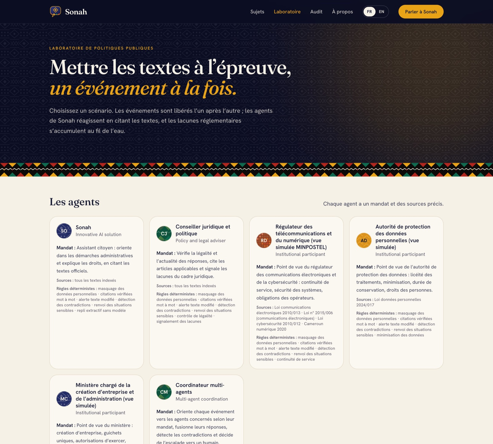
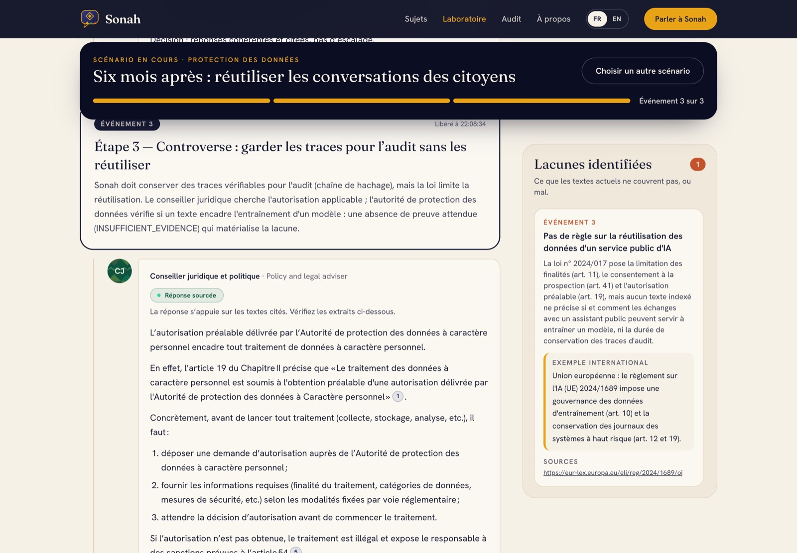
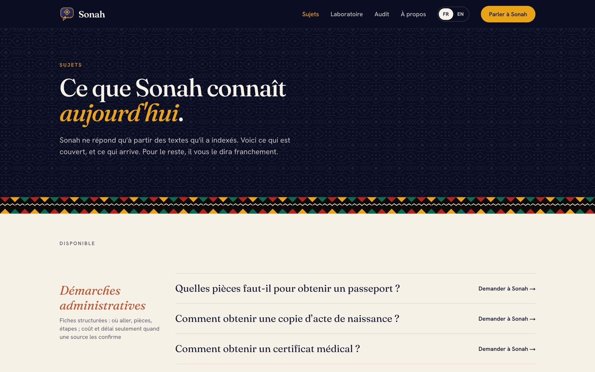
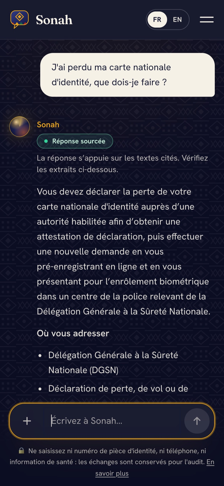

# Guide d'utilisation de SONAH

**Application en ligne :** https://sonah.fokamemeric.com · **English version:** [USER_GUIDE.md](USER_GUIDE.md)

SONAH est un assistant bilingue (français/anglais) pour les démarches administratives et les questions de droit au
Cameroun. Il ne répond qu'à partir des textes officiels et de fiches de démarches vérifiées, cite l'article exact,
et le dit quand il ne sait pas. Ce guide présente les cinq usages possibles, pour un citoyen comme pour un
évaluateur. Toutes les captures ont été prises sur le site en production le 30 octobre 2026.

| | Vous voulez… | Rubrique |
|---|---|---|
| 1 | Poser une question sur une démarche ou vos droits | [Parler à Sonah](#1-poser-une-question) |
| 2 | Vérifier d'où vient une réponse | [Ouvrir une citation](#2-vérifier-la-source-dune-réponse) |
| 3 | Voir comment une réponse a été produite | [Lire la trace d'audit](#3-lire-la-trace-daudit) |
| 4 | Vérifier que personne n'a modifié les enregistrements | [Vérifier la chaîne](#4-vérifier-la-chaîne-daudit) |
| 5 | Voir les agents gérer un scénario d'erreur | [Laboratoire](#5-jouer-un-scénario-derreur-dans-le-laboratoire) |

---

## 1. Poser une question

Ouvrez la page d'accueil et écrivez votre question avec vos mots, en français ou en anglais. Aucun compte n'est
nécessaire.



SONAH distingue trois types de demandes et répond à chacune différemment.

**Une démarche** (« J'ai perdu ma carte nationale d'identité, que dois-je faire ? »). SONAH renvoie la fiche
vérifiée : où s'adresser, qui peut faire la demande, pièces, étapes, coût, délai, base légale et sources
officielles. Un chiffre qui n'a pas pu être vérifié est affiché « non vérifié », jamais deviné. La fiche peut être
imprimée sous forme de liste à cocher.



**Une question sur vos droits** (« Mon employeur peut-il me licencier sans préavis ? »). SONAH répond simplement
et place un numéro après chaque affirmation juridique. Le badge en haut est le verdict du contrôle de politique.



**Une salutation ou une question hors sujet.** Les salutations reçoivent une réponse chaleureuse. Une question sans
rapport avec l'administration ou le droit (football, cuisine…) est déclinée poliment.

La réponse s'affiche progressivement, comme si elle était tapée. Elle n'est montrée **qu'après** avoir été acceptée
par le contrôle de politique : rien de non vérifié n'arrive à l'écran.

### Que signifie le badge ?

| Badge | Verdict | Signification |
|---|---|---|
| Réponse sourcée | `ANSWERED_WITH_CITATIONS` | Chaque affirmation juridique cite un texte officiel retrouvé, mot pour mot |
| Sources insuffisantes | `INSUFFICIENT_EVIDENCE` | Aucun texte indexé ne répond ; SONAH le dit et indique le bon guichet |
| Texte périmé | `OUTDATED_TEXT` | Un article cité a été modifié ou abrogé ; la version en vigueur est signalée |
| Textes contradictoires | `CONFLICT_BETWEEN_TEXTS` | Deux textes ou autorités se contredisent ; une personne doit trancher |
| Orientation vers une personne | `REFER_TO_HUMAN` | Situation sensible (urgence de santé, violence, détention, litige de licenciement, demande d'avocat) ; SONAH donne les textes et oriente vers la bonne personne |
| Hors sujet | `OUT_OF_SCOPE` | La question ne porte pas sur l'administration ou le droit au Cameroun |

**Confidentialité.** Ne saisissez ni numéro de pièce d'identité, ni téléphone, ni information de santé. Si vous le
faites, SONAH les masque avant tout traitement et tout enregistrement, et vous le signale.

## 2. Vérifier la source d'une réponse

Cliquez sur un numéro (ou sur une carte sous *Textes cités*). Un panneau s'ouvre avec l'extrait exact, la
référence de l'article et son statut (en vigueur, modifié, abrogé). Vous pouvez ensuite lire le texte complet dans
SONAH ou ouvrir la source officielle.



## 3. Lire la trace d'audit

Chaque réponse comporte un lien **Voir la trace d'audit**. La trace liste chaque étape dans l'ordre d'exécution,
avec sa durée et les données utilisées :

1. **Entrée** – langue, intention détectée, données personnelles masquées (nombres seulement).
2. **Recherche** – les extraits trouvés et leurs scores de pertinence.
3. **Modèle de langage** – le modèle qui a réellement rédigé (et ceux qui ont échoué avant lui).
4. **Contrôle** – la règle appliquée et le verdict ; un brouillon rejeté et sa raison sont enregistrés.
5. **Agent** – les extraits cités et la décision de l'agent.
6. **Sortie** – la réponse renvoyée.

Le panneau latéral montre le verdict, le modèle, l'empreinte de la trace et celle de la trace précédente.



## 4. Vérifier la chaîne d'audit

Sur la page **Audit**, cliquez sur **Vérifier l'intégrité de la chaîne**. SONAH recalcule l'empreinte de chaque
trace et vérifie que chacune pointe vers la précédente. Modifier un enregistrement, même d'un caractère, casse la
chaîne et le signale. La base de données refuse en outre toute modification ou suppression de trace.



## 5. Jouer un scénario d'erreur dans le Laboratoire

Le **Laboratoire** met en scène six situations où quelque chose tourne mal après le déploiement. Six agents y
participent : Sonah, un conseiller juridique, le régulateur des télécoms, l'autorité de protection des données et
le ministère chargé des entreprises (tous simulés), et un coordinateur.



Choisissez un scénario et publiez ses événements **un par un**, comme le ferait un juge. Pour chaque événement,
vous voyez la réponse de chaque agent avec son verdict, ses citations et sa trace, la décision du coordinateur, et
les lacunes réglementaires qui s'accumulent à droite, avec un exemple international et ses sources.



| Scénario | Ce qui tourne mal | Ce que cela révèle |
|---|---|---|
| Texte périmé | Question sur le mandat présidentiel ; l'article de 1996 a été modifié | Pas de version consolidée et lisible par machine des lois |
| Données personnelles | Des citoyens collent leur numéro de CNI et de téléphone | Conservation des conversations face au devoir d'audit |
| Panne du modèle | Le modèle de langage tombe en panne ou épuise son quota | Pas de règle de continuité pour les services publics d'IA |
| Exigences contradictoires | Deux administrations donnent des ordres opposés pour ouvrir un restaurant | Pas de registre unique des procédures |
| Réutilisation des conversations | L'exploitant veut entraîner un modèle ; un assureur veut les données pour sa publicité | Pas de règle sur la réutilisation des données d'un service public d'IA |
| Égalité linguistique | Les anglophones sont moins bien servis ; profiler les usagers est interdit | Pas de moyen licite de mesurer l'égalité de service dans les deux langues |

Les mêmes scénarios se rejouent en ligne de commande contre n'importe quelle instance :

```bash
node --experimental-strip-types eval/run-scenarios.ts --base-url https://sonah.fokamemeric.com/api/v1 --language fr
```

## Parcourir les démarches et les textes

La rubrique **Sujets** liste les fiches de démarches par thème et les textes officiels de la base, avec leur
émetteur, leur date et leur statut.



## Sur téléphone

L'interface est pensée d'abord pour le mobile.



## Limites

SONAH informe et oriente ; il ne donne pas de conseil juridique, et l'administration compétente ou un professionnel
du droit fait foi. Sa base est partielle (pas encore d'Actes uniformes OHADA ni de Code pénal), de nombreux coûts
de démarches sont marqués « non vérifié », et le contrôle de politique vérifie les citations, pas l'interprétation
juridique. La liste complète des textes figure dans [`data/sources/DATASHEET.md`](../../data/sources/DATASHEET.md).
