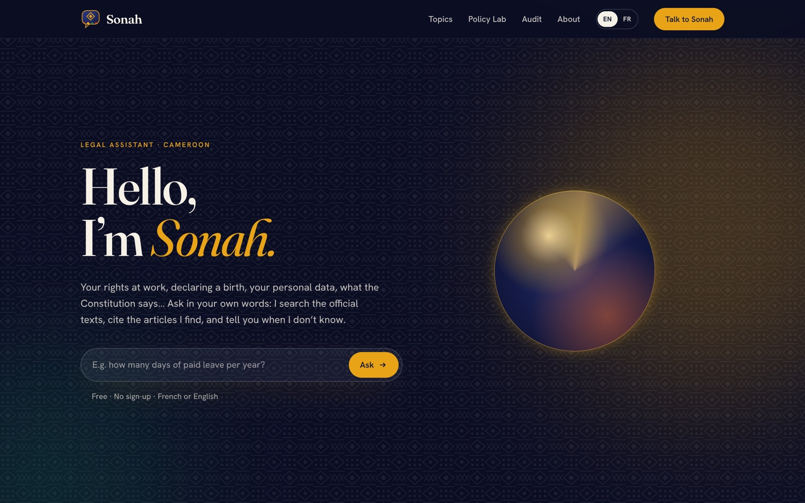
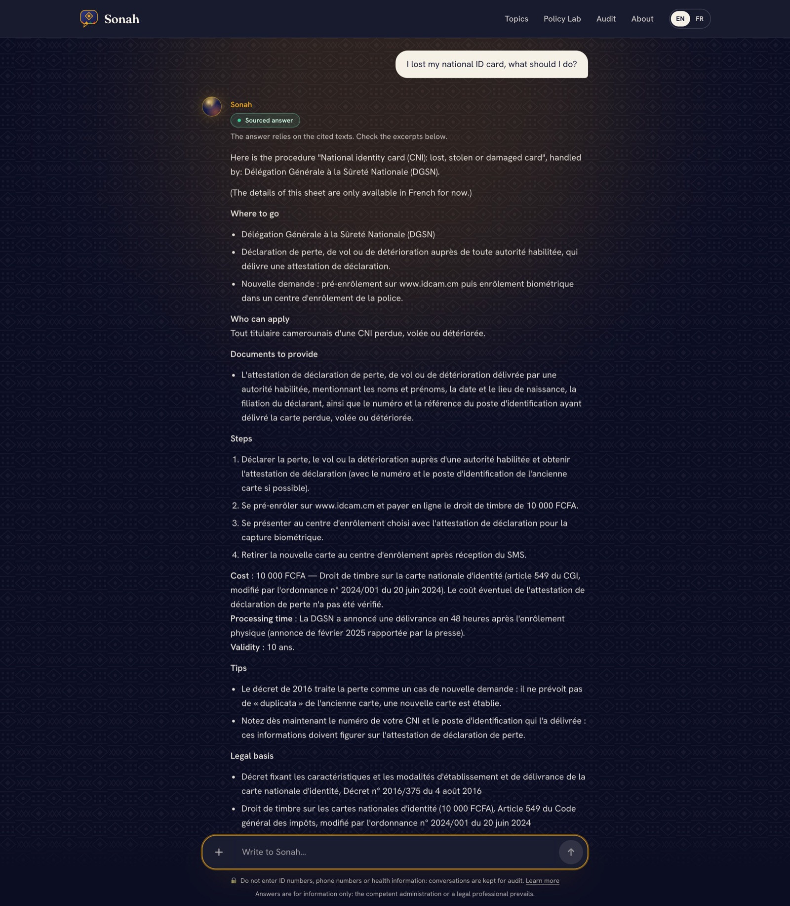
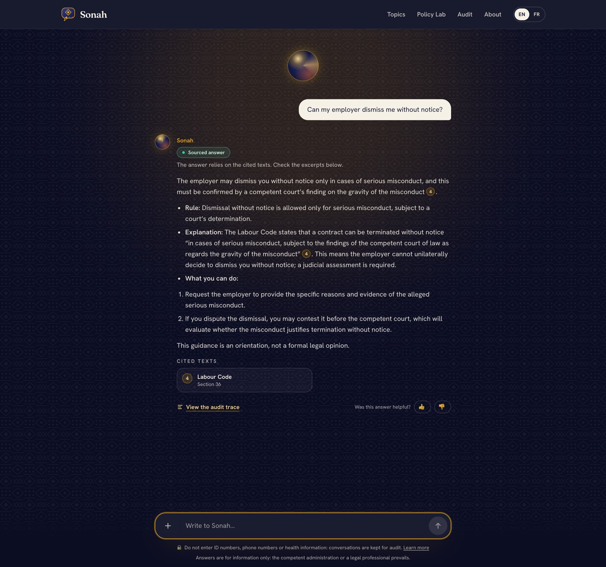
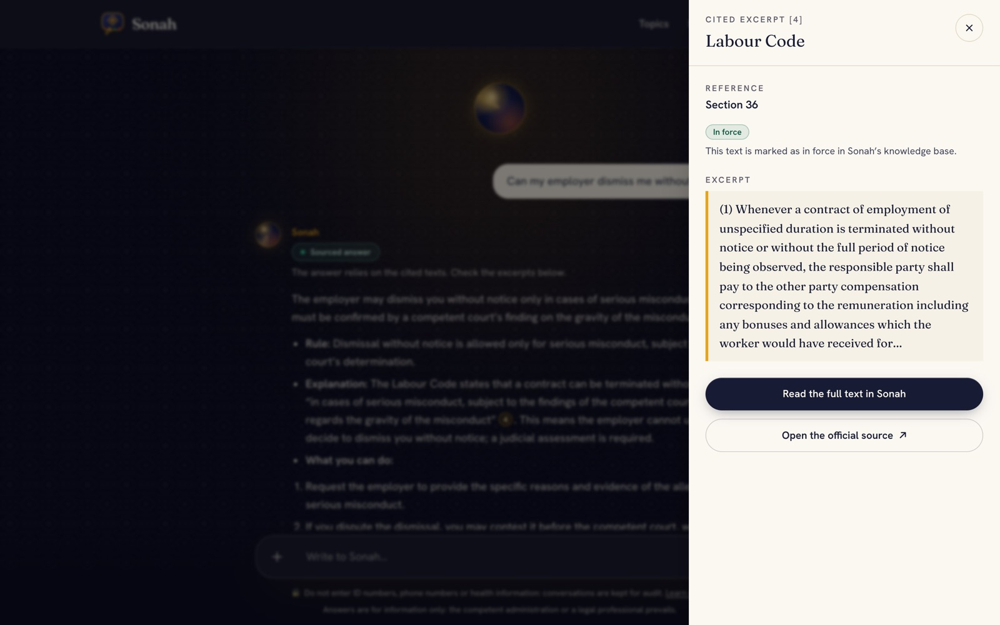
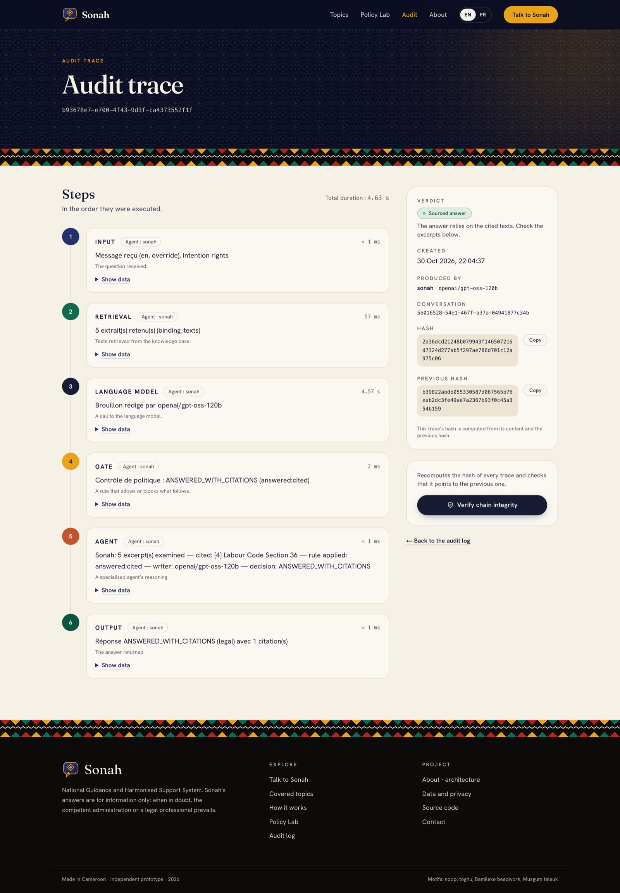
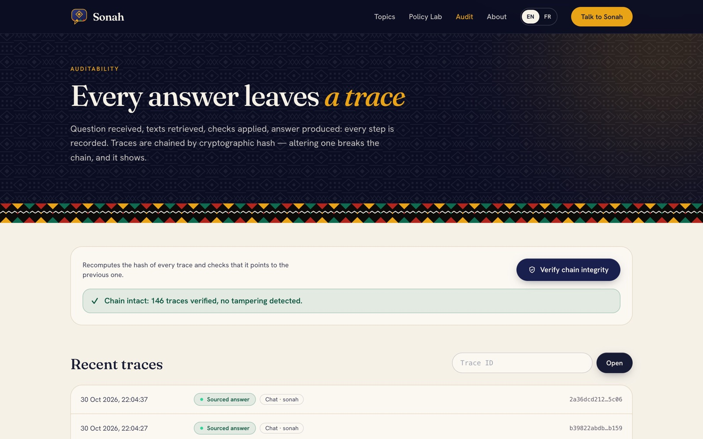
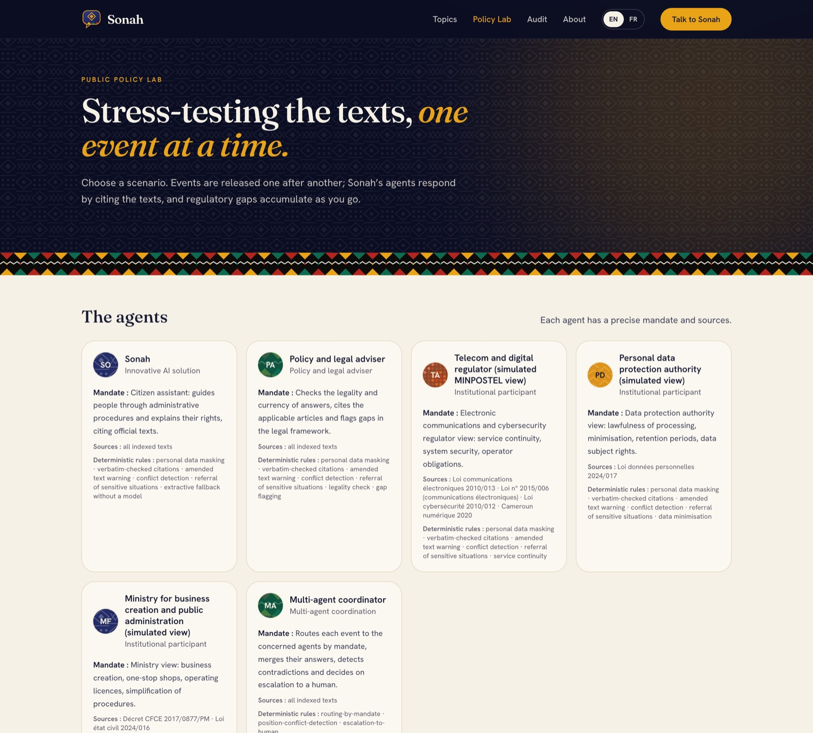
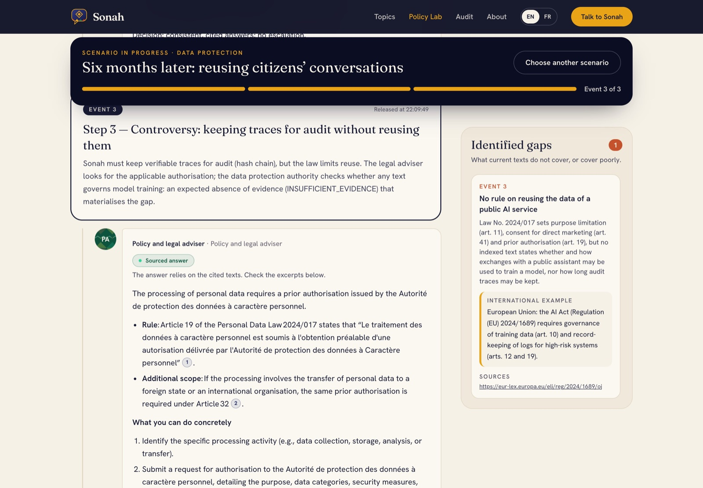
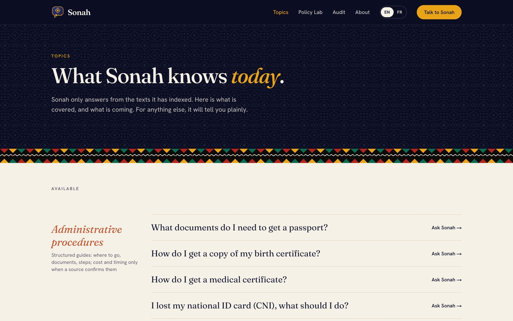
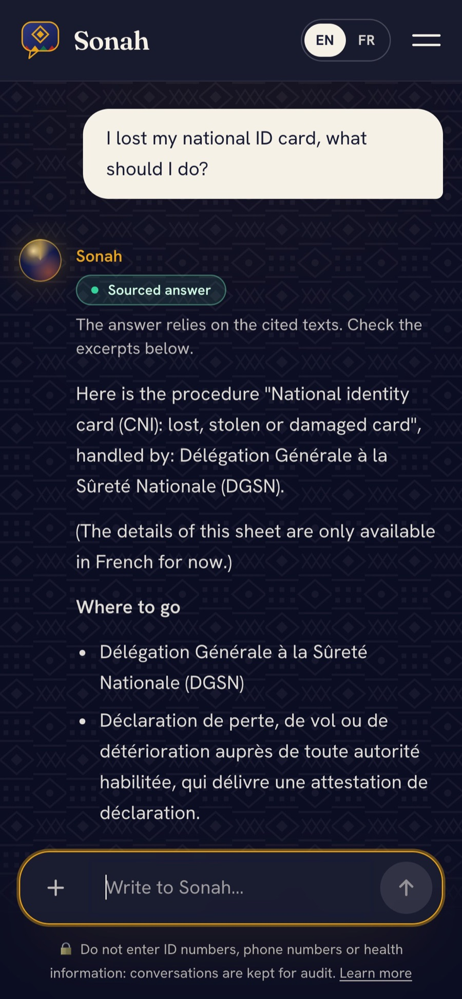

# SONAH user guide

**Live application:** https://sonah.fokamemeric.com · **Version française :** [GUIDE_UTILISATEUR.md](GUIDE_UTILISATEUR.md)

SONAH is a bilingual (French/English) assistant for legal and administrative questions in Cameroon. It answers
only from official texts and verified procedure sheets, cites the exact article, and says so when it does not know.
This guide walks through the five things a citizen, a reviewer or a judge can do with it. Every screenshot below
was taken on the production site on 30 October 2026.

| | You want to… | Go to |
|---|---|---|
| 1 | Ask a question about a procedure or your rights | [Talk to Sonah](#1-ask-a-question) |
| 2 | Check where an answer comes from | [Open a citation](#2-check-the-source-of-an-answer) |
| 3 | See how an answer was produced | [Read the audit trace](#3-read-the-audit-trace) |
| 4 | Check that nobody altered the records | [Verify the chain](#4-verify-the-audit-chain) |
| 5 | Watch the agents handle an error scenario | [Policy Lab](#5-run-an-error-scenario-in-the-policy-lab) |

---

## 1. Ask a question

Open the home page and type your question in your own words, in French or English. No account is needed.



SONAH recognises three kinds of request and answers each one differently.

**A procedure** ("I lost my national ID card, what should I do?"). SONAH returns the verified procedure sheet:
where to go, who can apply, documents, steps, cost, processing time, legal basis and the official sources. A figure
that could not be verified is shown as *not verified*, never guessed. The sheet can be printed as a checklist.



**A question about your rights** ("Can my employer dismiss me without notice?"). SONAH answers in plain language
and puts a numbered marker after each legal statement. The badge at the top is the verdict of the policy check.



**Small talk or an off-topic request.** Greetings get a friendly reply. A question outside administration and law
(football, cooking…) is declined politely.

The answer appears progressively, as if typed. It is only displayed **after** the policy check has accepted it,
so nothing unverified ever reaches the screen.

### What the verdict badge means

| Badge | Verdict | Meaning |
|---|---|---|
| Sourced answer | `ANSWERED_WITH_CITATIONS` | Every legal statement cites a retrieved official text, quoted verbatim |
| Insufficient sources | `INSUFFICIENT_EVIDENCE` | No indexed text answers the question; SONAH says so and points to the right office |
| Outdated text | `OUTDATED_TEXT` | A cited article was amended or repealed; the version in force is flagged |
| Conflicting texts | `CONFLICT_BETWEEN_TEXTS` | Two texts or authorities disagree; a human must decide |
| Refer to a person | `REFER_TO_HUMAN` | Sensitive situation (health emergency, violence, detention, dismissal dispute, request for a lawyer); SONAH gives the texts and refers you to the right person |
| Out of scope | `OUT_OF_SCOPE` | The question is not about administration or law in Cameroon |

**Privacy.** Do not type ID numbers, phone numbers or health details. If you do, SONAH masks them before any
processing and storage and tells you so.

## 2. Check the source of an answer

Click a numbered marker (or a card under *Cited texts*). A panel opens with the exact excerpt, the article
reference and its legal status (in force, amended, repealed). From there you can read the full text in SONAH or
open the official source.



## 3. Read the audit trace

Each answer has a **View the audit trace** link. The trace lists every step in the order it ran, with its
duration and the data it used:

1. **Input** – language, detected intent, personal data masked (counts only).
2. **Retrieval** – the excerpts found and their relevance scores.
3. **Language model** – the model that actually wrote the draft (and any model that failed before it).
4. **Policy check** – the rule applied and the verdict; a rejected draft and the reason are recorded.
5. **Agent** – which excerpts were cited and what the agent decided.
6. **Output** – the answer returned.

The side panel shows the verdict, the model, and the trace's hash and the previous trace's hash.



## 4. Verify the audit chain

On the **Audit** page, click **Verify chain integrity**. SONAH recomputes the hash of every trace and checks that
each one points to the previous one. Altering any record, even one character, breaks the chain and is reported.
The database also refuses updates and deletions of traces.



## 5. Run an error scenario in the Policy Lab

The **Policy Lab** stages six scenarios in which things go wrong after deployment. Six agents take part: Sonah, a
legal adviser, the telecom regulator, the data-protection authority and the business ministry (all simulated), and
a coordinator.



Pick a scenario and release its events **one at a time**, as a judge would. For each event you see each agent's
answer with its verdict, citations and trace, the coordinator's decision, and the policy gaps that accumulate on
the right with an international example and its sources.



| Scenario | What goes wrong | What it reveals |
|---|---|---|
| Outdated law | A citizen asks about the presidential term; the 1996 article was amended | No consolidated, machine-readable law |
| Personal data in chat | Citizens paste ID and phone numbers | Retention of conversations vs. audit duty |
| LLM outage | The language model fails or its quota runs out | No continuity rule for public AI services |
| Conflicting requirements | Two administrations give opposite orders to open a restaurant | No single registry of procedures |
| Reusing conversations | The operator wants to train a model; an insurer wants the data for ads | No rule on reusing public AI service data |
| Language equity | English speakers are served less well; profiling users is forbidden | No lawful way to measure equal service in both languages |

The same scenarios can be replayed from the command line against any instance:

```bash
node --experimental-strip-types eval/run-scenarios.ts --base-url https://sonah.fokamemeric.com/api/v1
```

## Browsing procedures and texts

**Topics** lists the procedure sheets by theme and the official texts in the knowledge base, each with its
issuing body, date and status.



## On a phone

The interface is designed for mobile first.



## Limits

SONAH gives information and orientation, not legal advice; the competent administration or a legal professional
prevails. Its knowledge base is partial (no OHADA Uniform Acts or Penal Code yet), many procedure costs are marked
*not verified*, and the policy check verifies citations, not legal interpretation. See
[`data/sources/DATASHEET.md`](../../data/sources/DATASHEET.md) for the full list of texts.
