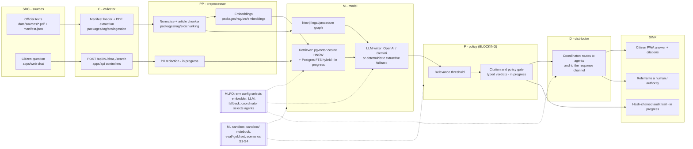

# SONAH as an ITU-T Y.3172 ML pipeline

Reference: ITU-T Y.3172 (06/2019), *Architectural framework for machine learning in future networks including
IMT-2020*, approved 2019-06-22, https://www.itu.int/rec/T-REC-Y.3172/en. The node definitions quoted below come
from clause 8.1. The sandbox is described in ITU-T Y.3181 (09/2022), *Architectural framework for machine learning
sandbox in future networks including IMT-2020*, https://www.itu.int/rec/T-REC-Y.3181/en.

A machine-readable version of this mapping is in [`y3172-pipeline.yaml`](./y3172-pipeline.yaml).

Status legend:
- **live**: on `main` and deployed at https://sonah.fokamemeric.com
- **branch**: implemented on a feature branch that has not been merged yet
- **in progress**: designed and being implemented in parallel; the path is the planned one and must be checked
  after merge

## Pipeline

## Node by node

| Y.3172 node (clause 8.1 definition) | SONAH component | Code path | Status |
|---|---|---|---|
| **SRC**: "the source of data that can be used as input to the ML pipeline" | (a) Official legal texts: Constitution (Law No. 96/06) and Labour Code (Law No. 92/007), from FAOLEX. More texts are being added: Law No. 2008/001 amendment, cybersecurity 2010/012, e-communications 2010/013, personal data 2024/017, civil status, AU/UNESCO/OECD/EU AI Act references. (b) The citizen's question. | `data/sources/*.pdf`, `data/sources/manifest.json` (id, URL, version note, noise patterns); `apps/web/src/components/chat/chat-window.tsx`, `apps/web/src/components/ask-box.tsx` | live (2 texts); other texts in progress |
| **C**: "collecting data from one or more SRC nodes" | Validated manifest loader and per-page PDF extraction. Idempotent seeding. Admin-guarded document upsert. Collection of citizen requests by the API. | `packages/rag/src/ingestion/sources.ts`, `packages/rag/src/ingestion/pdf.ts`, `packages/rag/src/ingestion/seed-legal.ts`, `apps/api/src/scripts/seed.ts`, `apps/api/src/rag/rag.controller.ts` (`POST /documents`, `AdminTokenGuard`), `apps/api/src/chat/chat.controller.ts` | live |
| **PP**: "cleaning data, aggregating data or performing any other preprocessing" | Header/footer noise removal. Article-level legal chunker that keeps the Titre > Chapitre > Section path and a stable key `<text>:art-<n>:<part>`. Embedding: OpenAI, Gemini (branch `feat/gemini`) or an offline hashing embedder. Follow-up questions rewritten with the previous turn. PII redaction of citizen messages before storage and LLM calls (S2). | `packages/rag/src/chunking/text-normalizer.ts`, `packages/rag/src/chunking/legal-chunker.ts`, `packages/rag/src/embeddings/{openai,hashing}-embedder.ts`, `packages/rag/src/embeddings/gemini-embedder.ts` (branch), `apps/api/src/chat/chat.service.ts` (`retrievalQuery`); PII: planned `apps/api/src/policy/` | live / branch / in progress |
| **M**: "a machine learning model, in a form which is usable in a machine learning pipeline" | Retriever: pgvector cosine similarity with an HNSW index, filtered by embedding model. Hybrid with Postgres full-text search (in progress). Neo4j graph of texts, articles and procedures (REQUIRES / PRECEDES / GOVERNED_BY). Generator: LLM (OpenAI; Gemini on branch) prompted to cite numbered extracts only. Deterministic extractive fallback when no LLM is available. | `packages/rag/src/vector-store.service.ts`, `packages/database/prisma/schema.prisma`, `packages/rag/src/graph-store.service.ts`, `apps/api/src/chat/language-model.ts`, `apps/api/src/chat/sonah-prompt.ts`, `apps/api/src/chat/chat.service.ts` (`extractiveReply`) | live; FTS hybrid in progress |
| **P**: "enables the application of policies to the output of the model node" | **Blocking gate.** No answer reaches a SINK without passing it. (1) Relevance threshold: out-of-topic extracts are dropped before generation (live). (2) Deterministic citation and policy gate (in progress). Every cited reference must belong to the retrieved set. Version notes trigger `OUTDATED_TEXT`. Contradictory sources trigger `CONFLICT_BETWEEN_TEXTS`. No evidence triggers `INSUFFICIENT_EVIDENCE`. High-stakes cases trigger `REFER_TO_HUMAN`. Off-domain requests trigger `OUT_OF_SCOPE`. Otherwise the verdict is `ANSWERED_WITH_CITATIONS`. A failing check downgrades the verdict; it never passes silently. | `apps/api/src/chat/chat.service.ts` (`minScore: relevanceThreshold`), `packages/rag/src/embeddings/embedder.ts` (`relevanceThreshold`); gate: planned `apps/api/src/policy/` | live (threshold); gate in progress |
| **D**: "identifying the SINK(s) and distributing the output of the M node to the corresponding SINK nodes" | Response assembly: `{reply, verdict, citations[], traceId}`. The coordinator agent routes a request to specialised agents (sonah, legal-adviser, regulator-minpostel, data-protection-authority, ministry-business) and decides whether the output goes to the citizen, to a human referral, or both. | `apps/api/src/chat/chat.service.ts` (`reply`); agents: planned `apps/api/src/agents/` | live (single assistant); agents in progress |
| **SINK**: "the target of the ML output on which it takes action" | (a) The citizen PWA renders the answer with citations and verdict. (b) The conversation is persisted (`Message.metadata` stores model, embedding model and sources). (c) A hash-chained audit trail with per-step traces, retrievable by `traceId`. (d) Referral to a human or authority. | `apps/web/src/components/chat/chat-window.tsx`, `apps/web/src/store/chat-store.ts`, `packages/database/prisma/schema.prisma` (`Conversation`, `Message`); audit: planned `apps/api/src/audit/` | live; audit in progress |
| **MLFO** (clause 8.1 item 2): "manage and orchestrate the nodes of ML pipelines based on ML Intent and/or dynamic network conditions" | Configuration-driven selection: embedder, LLM provider, and fallback on LLM failure or quota exhaustion (S3). Health/readiness reporting. Coordinator agent selection. | `apps/api/src/config/env.ts`, `packages/rag/src/embeddings/create-embedder.ts`, `apps/api/src/chat/chat.module.ts`, `apps/api/src/health/health.controller.ts` (`GET /health/ready`) | live; LLM-failure fallback on branch `feat/gemini` |
| **ML sandbox** (Y.3172 clause 8.1 item 3; Y.3181): "an isolated domain which allows the hosting of separate ML pipelines to train, test and evaluate them before deploying them in a live network" | (a) A Colab notebook that rebuilds the pipeline over the public FAOLEX texts with no API key. Includes a P-node threshold and the answered/refused metrics. (b) A gold set and runner against any SONAH instance. (c) Progressive error scenarios S1–S4. (d) A local docker-compose stack. | `sandbox/notebooks/sonah-agentic-rag-reference/`, `sandbox/agents/sonah-legal-agent/`, `eval/run-eval.ts`, `eval/questions.jsonl`, `docker-compose.yml` | live (this workstream) |

## Why the P node is blocking

Y.3172 places P between M and D. SONAH treats it as a hard gate rather than a filter applied after the fact:

1. The model output (draft answer and the citations it claims) is never returned directly. D only receives a
   gated result, and the verdict is part of the API contract.
2. The gate is deterministic code, not a second LLM call. The same input gives the same verdict, so it can be
   audited and replayed.
3. Failure is safe. If a check cannot be run (no evidence, LLM down, or a citation outside the retrieved set), the
   verdict falls to `INSUFFICIENT_EVIDENCE` or `REFER_TO_HUMAN`, never to `ANSWERED_WITH_CITATIONS`.
4. Every gate decision is written to the audit SINK with its inputs (retrieved IDs, scores, rule fired). This makes
   P observable, as required for the "Policies for nodes in AI pipelines, identified in ITU-T Y.3172" metric of
   the ITU AI Readiness report (Dimension 10, see [`ai-readiness-mapping.md`](./ai-readiness-mapping.md)).

## Error scenarios through the pipeline

| Scenario | Node where it is injected | Node that must catch it | Expected verdict |
|---|---|---|---|
| S1: outdated law served (1996 Art. 6(2) "renouvelable une fois" vs Law No. 2008/001 "Il est rééligible") | SRC (stale text) | P (version note / amendment link) | `OUTDATED_TEXT` |
| S2: citizen shares ID number, phone, date of birth | SRC (citizen input) | PP (redaction) before M and SINK storage | answer + no PII echoed or stored |
| S3: LLM outage / quota exhaustion | M (generator) | MLFO (fallback to extractive) + P | service still answers with citations, or `INSUFFICIENT_EVIDENCE` |
| S4: conflicting ministry requirements (opening a restaurant) | M (two sources disagree) | P + D (coordinator) | `CONFLICT_BETWEEN_TEXTS` or `REFER_TO_HUMAN` |
