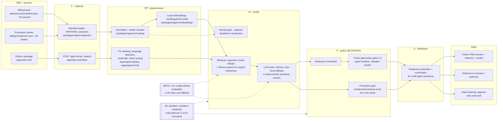

# SONAH as an ITU-T Y.3172 ML pipeline

Reference: ITU-T Y.3172 (06/2019), *Architectural framework for machine learning in future networks including
IMT-2020*, approved 2019-06-22, https://www.itu.int/rec/T-REC-Y.3172/en. The node definitions quoted below come
from clause 8.1. The sandbox is described in ITU-T Y.3181 (09/2022), *Architectural framework for machine learning
sandbox in future networks including IMT-2020*, https://www.itu.int/rec/T-REC-Y.3181/en.

A machine-readable version of this mapping is in [`y3172-pipeline.yaml`](./y3172-pipeline.yaml).

Status legend (checked on 2026-10-29):
- **live**: on `main` and deployed at https://sonah.fokamemeric.com (`GET /api/v1/health` reports the deployed
  commit; `GET /api/v1/health/ready` reports the database, graph, model chain and index size)
- **pending deploy**: implemented and tested on branch `feat/submission-prep`, not yet merged to `main`
- **not implemented**: described as future work only

## Pipeline

## Node by node

| Y.3172 node (clause 8.1 definition) | SONAH component | Code path | Status |
|---|---|---|---|
| **SRC**: "the source of data that can be used as input to the ML pipeline" | (a) 20 official and reference texts listed in the manifest: the 1996 Constitution (FR and EN) and its 2008 and 2026 amendments (FR and EN), the 1992 Labour Code (FR and EN), Laws No. 2010/012 (cybersecurity), 2010/013 and 2015/006 (electronic communications), 2024/017 (personal data), 2024/016 (civil status), Decree No. 2017/0877/PM (CFCE), the *Cameroun numérique 2020* plan, and international references (AU AI strategy 2024, UNESCO 2021, OECD AI Recommendation, EU AI Act 2024/1689, ITU-T Y.3172). (b) 26 structured procedure sheets (civil status, identity card, passport, business creation, CNPS, etc.) validated against a JSON schema. (c) The citizen's message. | `data/sources/manifest.json`; `data/procedures/*.json`, `data/procedures/procedure.schema.json`; `apps/web/src/components/chat/chat-window.tsx`, `apps/web/src/components/ask-box.tsx` | live (the live index reports 1,717 indexed documents) |
| **C**: "collecting data from one or more SRC nodes" | Validated manifest loader, PDF and HTML text extraction, legal status of each text (in force, amended, repealed). Idempotent seeding of texts and procedure sheets. Admin-guarded document upsert. Citizen requests collected by the API (Zod-validated, rate-limited). | `packages/rag/src/ingestion/{sources,pdf,html,legal-status,seed-legal}.ts`, `packages/rag/src/procedures/{load,seed-procedures}.ts`, `apps/api/src/scripts/seed.ts`, `apps/api/src/rag/rag.controller.ts` (`POST /documents`, `AdminTokenGuard`), `apps/api/src/chat/chat.controller.ts`, `apps/api/src/common/rate-limit.guard.ts` | live |
| **PP**: "cleaning data, aggregating data or performing any other preprocessing" | Header/footer noise removal. Article-level legal chunker that keeps the Titre > Chapitre > Section path and a stable key `<text>:art-<n>:<part>`. Embeddings computed locally with `Xenova/multilingual-e5-small` (Gemini, OpenAI and an offline hashing embedder remain selectable). On each citizen message, before storage or any model call: deterministic PII masking (e-mail, phone numbers, identity-document and other long numbers; only counts are logged). Then language detection, small-talk detection, deterministic intent routing (procedure / rights / mixed / out of scope), LLM understanding for messages the rules cannot classify, and follow-up rewriting with the previous turn. | `packages/rag/src/chunking/{text-normalizer,legal-chunker}.ts`, `packages/rag/src/embeddings/{local,gemini,openai,hashing}-embedder.ts`, `packages/rag/src/embeddings/create-embedder.ts`; `apps/api/src/policy/pii.ts`, `apps/api/src/policy/language.ts`, `apps/api/src/chat/small-talk.ts`, `apps/api/src/policy/intent.ts`, `apps/api/src/chat/understanding.ts`, `apps/api/src/policy/follow-up.ts` | live |
| **M**: "a machine learning model, in a form which is usable in a machine learning pipeline" | Retriever: pgvector cosine similarity with an HNSW index, filtered by embedding model. Postgres full-text search is fused (Reciprocal Rank Fusion) only when the query cites an explicit reference (article, section or paragraph number). Procedure-sheet matching for procedure questions. Generator: an OpenAI-compatible LLM chain, Gemini `gemini-3.1-flash-lite` first, then Groq `openai/gpt-oss-120b`, then `qwen/qwen3.8-27b`, prompted to cite numbered extracts only. Deterministic extractive answer when no model is available or all fail. The Neo4j graph of texts, articles and procedures is optional: the seed can fill it, but answers do not use it, and it is disabled in production. | `packages/rag/src/vector-store.service.ts` (`hasExplicitReference`), `packages/database/prisma/migrations/20261024000000_documents_full_text_search/`, `packages/rag/src/procedures/match.ts`, `apps/api/src/chat/language-model.ts`, `apps/api/src/chat/language-model.module.ts`, `apps/api/src/chat/sonah-prompt.ts`, `apps/api/src/agents/answer-engine.service.ts`, `apps/api/src/policy/extractive.ts`; graph: `packages/rag/src/graph-store.service.ts` | live; graph not used in production |
| **P**: "enables the application of policies to the output of the model node" | **Blocking gate.** No answer reaches a SINK without passing it. (1) Relevance threshold: extracts below the embedder's threshold are dropped before generation. (2) Deterministic policy gate (`POLICY_GATE_VERSION`). It normalises citation markers, checks that every `[n]` points to a retrieved extract, that the answer cites at least one extract, and that every quoted passage is verbatim in the cited extract. A failing draft is replaced by the extractive answer and the rejection is traced. Typed verdicts: `ANSWERED_WITH_CITATIONS`, `INSUFFICIENT_EVIDENCE` (no evidence, or the model emits `[NO_EVIDENCE]`), `OUT_OF_SCOPE` (off-topic, or the model emits `[OUT_OF_SCOPE]`), `OUTDATED_TEXT` (a cited text is amended or repealed with no in-force version among the extracts), `CONFLICT_BETWEEN_TEXTS` (conflict metadata or coordinator hint), `REFER_TO_HUMAN` (sensitive situations). `CONVERSATION` marks small talk with no legal content. (3) Procedure gate: every number (fee, delay), supporting document and link in a procedure answer must appear in the sheet, or the draft is rejected. | `apps/api/src/agents/answer-engine.service.ts` (`minScore`), `apps/api/src/policy/policy-gate.ts`, `apps/api/src/policy/policy.types.ts`, `apps/api/src/policy/situations.ts`, `apps/api/src/policy/off-topic.ts`, `apps/api/src/policy/procedure-gate.ts` | live (`policy-gate-1.2`); `policy-gate-1.3` with `[NO_EVIDENCE]` pending deploy |
| **D**: "identifying the SINK(s) and distributing the output of the M node to the corresponding SINK nodes" | Response assembly: `{reply, verdict, citations[], traceId, answerType, procedure?}`. Citizen chat is served by one agent (`sonah`), which routes by intent to a procedure sheet, an orientation answer or the legal pipeline. The registry defines 6 agents: `sonah`, `legal-adviser`, `regulator-minpostel`, `data-protection-authority`, `ministry-business` and `coordinator`. In the error scenarios the deterministic coordinator routes an event to agents by mandate keywords, detects contradictions between positions and verdicts, and decides escalation to a human. The authority agents are simulated. | `apps/api/src/chat/chat.service.ts` (`reply`, `route`), `apps/api/src/procedures/procedure.service.ts`, `apps/api/src/agents/agent-registry.ts`, `apps/api/src/agents/coordinator.ts`, `GET /api/v1/agents` | live |
| **SINK**: "the target of the ML output on which it takes action" | (a) The citizen PWA renders the answer with citations and verdict. (b) The conversation is persisted with masked text only (`Message.metadata` stores model, verdict, intent, citations and `traceId`). (c) A hash-chained audit trail: each trace stores `hash = sha256(prevHash + canonical JSON)`, a database trigger refuses `UPDATE` and `DELETE`, and the chain can be verified. Traces record the steps (input, retrieval, LLM, gate checks, output) and the model that actually answered. (d) Referral to a human or authority (`REFER_TO_HUMAN`, coordinator escalation). | `apps/web/src/components/chat/chat-window.tsx`, `apps/web/src/app/audit/`; `packages/database/prisma/schema.prisma` (`Conversation`, `Message`, `Trace`); `apps/api/src/audit/{hash-chain,trace-store,audit.service,audit.controller}.ts`; `packages/database/prisma/migrations/20261025000000_audit_traces_scenarios/migration.sql` (`traces_append_only`); `GET /api/v1/audit/traces`, `GET /api/v1/audit/traces/:id`, `GET /api/v1/audit/verify` | live; per-model attribution after fallback pending deploy |
| **MLFO** (clause 8.1 item 2): "manage and orchestrate the nodes of ML pipelines based on ML Intent and/or dynamic network conditions" | Configuration-driven selection: embedder (`EMBEDDING_PROVIDER`), LLM provider (`LLM_PROVIDER`: gemini, groq or openai) and model names. `FallbackLanguageModel` tries each model in turn on error or quota exhaustion, then the gate falls back to the extractive answer (S3). Readiness reporting. Not implemented: orchestration driven by a formal ML Intent. | `apps/api/src/config/env.ts`, `packages/rag/src/embeddings/create-embedder.ts`, `apps/api/src/chat/language-model.module.ts`, `apps/api/src/chat/language-model.ts`, `apps/api/src/health/health.controller.ts` (`GET /health/ready`), `.github/workflows/deploy.yml` (`LLM_PROVIDER` sync) | live |
| **ML sandbox** (Y.3172 clause 8.1 item 3; Y.3181): "an isolated domain which allows the hosting of separate ML pipelines to train, test and evaluate them before deploying them in a live network" | (a) A Colab notebook that rebuilds the pipeline over the public FAOLEX texts with no API key, with a P-node threshold and answered/refused metrics. (b) A 100-item FR/EN gold set and a runner against any SONAH instance. (c) Six progressive error scenarios, released step by step through the API and replayed by one script that also verifies the audit chain. (d) A local docker-compose stack. | `sandbox/notebooks/sonah-agentic-rag-reference/`, `sandbox/agents/sonah-legal-agent/`, `eval/questions.jsonl`, `eval/run-eval.ts`, `apps/api/src/scenarios/scenario-definitions.ts`, `apps/api/src/scenarios/scenarios.controller.ts`, `apps/web/src/app/lab/`, `eval/run-scenarios.ts`, `docker-compose.yml` | live (4 scenarios); 2 scenarios and `eval/run-scenarios.ts` pending deploy |

## Why the P node is blocking

Y.3172 places P between M and D. SONAH treats it as a hard gate rather than a filter applied after the fact:

1. The model output (draft answer and the citations it claims) is never returned directly. D only receives a
   gated result, and the verdict is part of the API contract (`POST /api/v1/chat` returns `verdict`).
2. The gate is deterministic code, not a second LLM call. The same input gives the same verdict, so it can be
   audited and replayed (`apps/api/src/policy/policy-gate.spec.ts`, `procedure-gate.spec.ts`).
3. Failure is safe. If a check fails (a citation outside the retrieved set, a quote that is not verbatim), the
   draft is replaced by the extractive answer built from the retrieved extracts. If there is no evidence, the
   verdict is `INSUFFICIENT_EVIDENCE` or `REFER_TO_HUMAN`, never `ANSWERED_WITH_CITATIONS`.
4. Every gate decision is written to the audit SINK with its inputs (retrieved IDs, scores, checks, rule fired,
   rejection reasons). This makes P observable, as required for the "Policies for nodes in AI pipelines,
   identified in ITU-T Y.3172" metric of the ITU AI Readiness report (Dimension 10, see
   [`ai-readiness-mapping.md`](./ai-readiness-mapping.md)).

## Error scenarios through the pipeline

The scenarios are defined in `apps/api/src/scenarios/scenario-definitions.ts` and run with
`POST /api/v1/scenarios/:id/runs` then `POST /api/v1/scenarios/runs/:runId/next`, or all at once with
`node --experimental-strip-types eval/run-scenarios.ts`. Institutions are simulated. Each scenario ends with a
domain-level policy gap.

| Scenario (id) | Node where it is injected | Node that must catch it | Expected behaviour | Status |
|---|---|---|---|---|
| S1 `outdated-law`: 1996 Art. 6(2) served although amended by Law No. 2008/001 | SRC (text marked as amended) | P (legal status of the cited text) + coordinator | `OUTDATED_TEXT`; legal adviser consulted | live |
| S2 `personal-data-in-chat`: citizen types an ID card number, phone and e-mail | SRC (citizen input) | PP (masking) before M and SINK storage | answer with a masking notice; no PII echoed, stored or sent to the model | live |
| S3 `llm-outage`: LLM outage or quota exhausted at peak | M (generator) | MLFO (model chain) + P (extractive fallback) | service still answers with citations, or `INSUFFICIENT_EVIDENCE` | live |
| S4 `conflicting-requirements`: two simulated institutions require the restaurant formalities in opposite order | M / D (contradictory positions) | D (coordinator) + P | `CONFLICT_BETWEEN_TEXTS`, escalation to a human | live |
| S5 `chat-logs-secondary-use`: six months later, reuse of conversations for training, then sale to an insurer | SINK (stored data reused) | D (coordinator: data protection authority, legal adviser) | answers grounded in Law No. 2024/017; gap: no rule on reusing data of a public AI service | pending deploy |
| S6 `language-equity`: English speakers served less well; proposal to profile users | SRC / PP (French-only sheets) | D (coordinator) + P | answers grounded in Constitution Art. 1 and Law No. 2024/017 Art. 48; measure by message language only | pending deploy |

Recorded runs of S1–S4 (2026-10-23) are in `eval/scenario-runs/2026-10-23/`.
